# 🎨 Awesome 3D Texture Synthesis & Material Generation 🌐

  <strong>Curated Directory of Industry-Leading SaaS Platforms, Neural AI Texturing Models & Open-Source PBR Material Pipelines</strong>

  
  
  
  
  

  <em>High-resolution Physically Based Rendering (PBR) texture maps (<code>Albedo</code>, <code>Normal</code>, <code>Roughness</code>, <code>Metallic</code>, <code>Height</code>, <code>AO</code>), node-based procedural material authoring, 3D mesh texture projection, and diffusion-based text-to-texture synthesis.</em>

---

## 📌 Table of Contents

- [📊 Sector Overview & Market Dynamics](#-sector-overview--market-dynamics)
- [🏢 SaaS & Cloud-Hosted Platforms](#-saas--cloud-hosted-platforms)
- [💻 Open-Source GitHub Projects](#-open-source-github-projects)
- [🛠️ Recommended Modular Pipelines](#️-recommended-modular-pipelines)
- [🤝 How to Contribute](#-how-to-contribute)
- [⭐ Star History](#-star-history)
- [💖 Support & Sponsorship](#-support--sponsorship)
- [📜 Disclaimer](#-disclaimer)

---

## 📊 Sector Overview & Market Dynamics

The global **3D mapping, modeling, and digital material synthesis market** is valued at approximately **$8.3B–$12.6B** and projected to surge past **$25B+ by 2033** (CAGR ~14%–17%), accelerated by real-time game engines (Unreal Engine 5, Unity), spatial computing, digital twins, and generative 3D diffusion pipelines. 

Industry market dynamics are **moderately concentrated at the foundational ecosystem and software layer**—anchored by dominant enterprise platforms like **Adobe** (Substance 3D Designer/Painter/Sampler) and **Epic Games** (Fab / Quixel Megascans)—while simultaneously remaining **highly fragmented across specialized domain-specific scanned asset libraries, generative AI research checkpoints, and community-driven CC0 open repositories**.

---

## 🏢 SaaS & Cloud-Hosted Platforms

*Commercial solutions, curated scanned libraries, and parametric cloud asset suites sorted in descending order of parent company market capitalization and estimated revenue.*

| Platform | Company Valuation / Revenue | Starting Tier Pricing | Free Tier / Trial Limits | Key Highlights & Description |
| :--- | :--- | :--- | :--- | :--- |
| **[Adobe Substance 3D](https://adobe.com)** | ~$95B Market Cap (Adobe Inc.) | $24.99/mo (Texturing Plan) or $59.99/mo (Collection) | 30-day free trial (Full Collection access, all features; automatic transition unless cancelled; free non-commercial tier for verified students/educators) | Industry-standard commercial suite for node-based procedural material authoring (Designer), 3D PBR mesh painting (Painter), AI photo-to-material extraction (Sampler), and cloud parametric asset libraries. |
| **[Quixel Megascans (Fab)](https://quixel.com)** | ~$22.5B Valuation (Epic Games) | $0.00 (100% Free on Epic Games Fab) | Unlimited free downloads across the entire 23,000+ Megascans photogrammetry library with full commercial use and AI model training rights | Massive cloud repository of calibrated photogrammetry PBR surfaces, 3D scans, vegetation, decals, and environment atlases integrated directly into Epic Games Fab and Unreal Engine. |
| **[Textures.com](https://textures.com)** | ~$3.6M Estimated Annual Revenue | $13.00/mo (billed annually, 1,000 credits/mo) or $19.00/mo month-to-month | Free sample catalog tier with access to low/medium-resolution texture downloads at 0 credits for logged-in accounts; high-resolution PBR/SBS files require paid credits | Established digital surface and scanned texture repository offering photo-sourced surface atlases, seamless PBR texture sets, SBS source materials, and AI-assisted texturing utilities. |
| **[Poliigon & Poliigon Cloud](https://poliigon.com)** | ~$3.3M Estimated Annual Revenue | $6.99/mo (Starter credit plan) or $29.00/mo (Pro plan) | Free forever account granting perpetual download access to a curated catalog of 100+ free PBR textures, models, and HDRIs under a commercial-use Free License | Cloud-based library of ultra-high-resolution photorealistic PBR textures, surface imperfections, brushes, and architectural materials with native Blender, 3ds Max, and Cinema 4D plugins. |
| **[3D.sk](https://3d.sk)** | ~$1M–$2M Estimated Niche Revenue | €24.90/mo (Hobby plan, 25 credits/mo) or €59.90/mo (Commercial plan) | Limited free downloadable sample texture pack and photo reference sets to inspect resolution/quality prior to purchase (no recurring free credits) | Specialized commercial reference and material repository providing high-resolution human skin scans, anatomical surface maps, and organic textures for character artists. |
| **[GameTextures.com](https://gametextures.com)** | <$1M Estimated Niche Revenue | $11.00/mo (Indie plan) or $30.00/mo (Studio/Pro plan) | Free forever account providing access to rotating promotional freebie packs and a dedicated free sample catalog with restricted indie licensing | Cloud-hosted procedural and scanned PBR material library tailored for real-time game engines with customizable Substance SBSAR parameters and trim sheets. |
| **[Arroway Textures](https://arroway-textures.ch)** | <$1M Estimated Niche Revenue | €119.00 per full collection/volume (one-time purchase; no monthly recurring tier) | Free low-resolution downloadable sample textures for map testing and resolution evaluation across wood, stone, and tile categories | Commercial architectural visualization texture library specializing in ultra-high-resolution, tileable wood, concrete, stone, and fabric PBR map collections. |
| **[Poly Haven](https://polyhaven.com)** | Non-Profit / Community-Funded Platform | $0.00 / Free Open Access (100% community-patron supported) | Unlimited free downloads; 100% of the entire library is public domain under `CC0` with no account, paywall, or daily rate limits up to 16K resolution | Community-funded open-access platform hosting 100% free, `CC0` public-domain scanned PBR texture sets, HDRIs, and models with direct Blender and API integration. |
| **[ambientCG](https://ambientcg.com)** | Non-Profit / Community-Funded Platform | $0.00 / Free Open Access (100% community-patron supported) | Unlimited free downloads; 100% of all assets are public domain under `CC0` with zero paywalls, no login required, and full bulk download access | Public-domain (`CC0`) cloud repository offering thousands of high-resolution procedural and scanned PBR materials, SBSAR files, 3D scans, and decals. |

---

## 💻 Open-Source GitHub Projects

*Free and open-source applications, procedural material authoring suites, deep learning texture synthesis models, and Blender extensions sorted in descending order by GitHub Stars.*

1. **[Blender (`blender/blender`)](https://github.com/blender/blender)**   
   The world's leading open-source (`GPL-2.0+`) 3D creation suite, offering node-based procedural Shader Nodes, multi-tile UDIM texture painting, Cycles PBR map baking, and Open Shading Language (`OSL`) integration.

2. **[Tencent Hunyuan3D-2 (`Tencent-Hunyuan/Hunyuan3D-2`)](https://github.com/Tencent-Hunyuan/Hunyuan3D-2)**   
   State-of-the-art open-source generative 3D framework featuring `Hunyuan3D-Paint` for multi-view consistent, illumination-disentangled, high-resolution PBR texture map generation on arbitrary untextured meshes.

3. **[Dream Textures (`carson-katri/dream-textures`)](https://github.com/carson-katri/dream-textures)**   
   Popular open-source (`GPL-3.0`) Stable Diffusion integration for Blender that generates seamless tileable textures, complete PBR texture sets, and depth-projected viewport paintings directly in the 3D viewport.

4. **[Material Maker (`RodZill4/material-maker`)](https://github.com/RodZill4/material-maker)**   
   Flagship open-source (`MIT`) procedural material authoring and 3D texture painting application built on Godot Engine—offering 200+ procedural nodes, ray-traced ambient occlusion and normal baking, trim sheet generators, and export presets for Blender, Unity, Godot, and Unreal.

5. **[ArmorPaint (`armory3d/armorpaint`)](https://github.com/armory3d/armorpaint)**   
   GPU-accelerated open-source (`zlib`) standalone 3D PBR texture painting software designed as an ultra-fast, lightweight alternative to Substance Painter with ray-traced baking, live node shaders, and cross-platform tablet support.

6. **[Resynthesizer (`bootchk/resynthesizer`)](https://github.com/bootchk/resynthesizer)**   
   High-performance classic open-source (`GPL-2.0+`) algorithm suite for non-parametric example-based texture synthesis, seamless tileable pattern generation, smart hole filling, and theme transfer.

7. **[Materialize (`BoundingBoxSoftware/Materialize`)](https://github.com/BoundingBoxSoftware/Materialize)**   
   Classic standalone open-source (`GPL-3.0`) utility for extracting and generating complete PBR map packages (`Height`, `Normal`, `Metallic`, `Smoothness`, and `Ambient Occlusion`) from single photographic source images.

8. **[Texture-Synthesis (`EmbarkStudios/texture-synthesis`)](https://github.com/EmbarkStudios/texture-synthesis)**   
   Blazing-fast open-source (`MIT` / `Apache-2.0`) Rust library and CLI for example-based texture synthesis, guided texture generation, image inpainting, and seamless repeated tiling.

9. **[KTX-Software (`KhronosGroup/KTX-Software`)](https://github.com/KhronosGroup/KTX-Software)**   
   The Khronos Group's official open-source (`Apache-2.0`) toolset for encoding and validating GPU-ready `.ktx2` textures with Basis Universal supercompression (UASTC and ETC1S) for real-time WebGL, WebGPU, and 3D game engines.

10. **[Scenario Blender Plugin (`scenario-labs/blender-plugin`)](https://github.com/scenario-labs/blender-plugin)**   
    Open-source (`GPL-3.0-or-later`) native Blender extension bringing AI viewport texturing, consistent asset style engines, and PBR material generation directly to 3D artists.

11. **[TextureSynthesis (`mxgmn/TextureSynthesis`)](https://github.com/mxgmn/TextureSynthesis)**   
    Pioneering open-source implementation of example-based pixel texture synthesis algorithms by the creator of WaveFunctionCollapse.

12. **[SUPRA-Tex (`Supra-3D/SUPRA-Tex`)](https://github.com/Supra-3D/SUPRA-Tex)**   
    Super-aligned open-source (`Apache-2.0` / research) 3D texture generation framework combining MLLM reference-view PBR estimation, native surface observation encoding, and an Interleaved Flow Transformer to export relightable 4K `.glb` assets.

13. **[TEXTure (`TEXTurePaper/TEXTurePaper`)](https://github.com/TEXTurePaper/TEXTurePaper)**   
    Official PyTorch implementation of *"TEXTure: Text-Guided Texturing of 3D Shapes"*, utilizing depth-conditioned diffusion models to paint high-resolution textures onto untextured 3D meshes dynamically from novel viewpoints.

14. **[Texturize (`texturedesign/texturize`)](https://github.com/texturedesign/texturize)**   
    Python deep-learning and patch-based open-source (`MIT`) command-line tool for generating photorealistic textures, remixing surface variations, and synthesizing seamless PBR materials from input reference images.

15. **[Text2Tex (`daveredrum/Text2Tex`)](https://github.com/daveredrum/Text2Tex)**   
    ICCV 2023 open-source framework for text-driven texture synthesis incorporating view-aware diffusion priors, dynamic viewpoint selection, and depth-aware inpainting to eliminate seams and stretching.

16. **[DreamMat (`zzzyuqing/DreamMat`)](https://github.com/zzzyuqing/DreamMat)**   
    SIGGRAPH 2024 open-source method generating high-quality SVBRDF PBR materials from text descriptions or single images using geometry- and light-aware diffusion models.

17. **[MaterialAnything (`3DTopia/MaterialAnything`)](https://github.com/3DTopia/MaterialAnything)**   
    CVPR 2025 Highlight open-source foundation model for generating physically accurate PBR material maps (`Albedo`, `Roughness`, `Metallic`) on generated, scanned, and untextured 3D geometry alongside the 80K+ `Material3D` dataset.

18. **[Materia (`Metric/Materia`)](https://github.com/Metric/Materia)**   
    Open-source (`MIT`) standalone node-based procedural texture and PBR material authoring application written in C# and inspired by Substance Designer workflows.

19. **[SceneTex (`daveredrum/SceneTex`)](https://github.com/daveredrum/SceneTex)**   
    CVPR 2024 Highlight open-source framework generating globally consistent, high-resolution textures across multi-object indoor 3D scenes using cross-view diffusion attention.

20. **[Ubisoft La Forge Chord (`ubisoft/ubisoft-laforge-chord`)](https://github.com/ubisoft/ubisoft-laforge-chord)**   
    Open-source chain-of-rendering decomposition framework from Ubisoft La Forge estimating complete SVBRDF PBR material maps (`Base Color`, `Roughness`, `Height`, `Normal`) from AI-generated 2D textures.

21. **[Paint-it (`kaist-ami/Paint-it`)](https://github.com/kaist-ami/Paint-it)**   
    CVPR 2024 open-source text-to-texture synthesis pipeline leveraging Deep Convolutional Physically-Based Rendering (`DC-PBR`) parameter optimization to output high-fidelity relightable PBR UV texture maps.

22. **[InTeX (`ashawkey/InTeX`)](https://github.com/ashawkey/InTeX)**   
    Interactive text-to-texture synthesis codebase featuring unified depth-aware inpainting, camera view traversal, and real-time mesh surface texturing.

23. **[ComfyUI-TextureAlchemy (`amtarr/ComfyUI-TextureAlchemy`)](https://github.com/amtarr/ComfyUI-TextureAlchemy)**   
    Open-source modular ComfyUI node pack that synthesizes complete PBR map sets (`Albedo`, `Normal`, `Roughness`, `Metallic`, `AO`, `Height`, `Curvature`) from single input images with seamless tiling and ORM channel packing.

24. **[PATINA (`lovisdotio/fal-texture-pbr-generator`)](https://github.com/lovisdotio/fal-texture-pbr-generator)**   
    Open-source web-based AI PBR texture studio extracting BaseColor, Normal, Roughness, Metallic, and Displacement maps from natural language prompts or uploaded photos with real-time Three.js 3D sphere viewport previews.

25. **[Open Painter (`caspianmoon/open_painter`)](https://github.com/caspianmoon/open_painter)**   
    Free and open-source (`GPL-3.0+`) non-destructive PBR texturing suite running natively inside Blender 5.2+ with layer stacks, 8 PBR channels, 50 smart materials, curvature/normal mesh-map baking, and particle brushes.

---

## 🛠️ Recommended Modular Pipelines

For artists and technical directors building **subscription-free, 100% open-source 3D texturing workflows**:

- **Procedural Authoring & Painting**: Pair **[Material Maker](https://github.com/RodZill4/material-maker)** with **[ArmorPaint](https://github.com/armory3d/armorpaint)** or **[Open Painter](https://github.com/caspianmoon/open_painter)** inside **[Blender](https://github.com/blender/blender)** for complete node-based procedural texturing and direct 3D viewport painting.
- **Generative AI & Image-to-PBR Synthesis**: Use **[SUPRA-Tex](https://github.com/Supra-3D/SUPRA-Tex)** or **[Tencent Hunyuan3D-2](https://github.com/Tencent-Hunyuan/Hunyuan3D-2)** for mesh texturing, alongside **[ComfyUI-TextureAlchemy](https://github.com/amtarr/ComfyUI-TextureAlchemy)** and **[MaterialAnything](https://github.com/3DTopia/MaterialAnything)** for automated PBR channel decomposition.
- **Optimization & Game Engine Delivery**: Compress generated 4K/8K PBR textures into GPU-native `.ktx2` format with **[KTX-Software](https://github.com/KhronosGroup/KTX-Software)** to maximize rendering throughput in WebGPU, WebGL, Unreal Engine, and Unity.

---

## 🤝 How to Contribute

Contributions are warmly welcomed! Help keep this ecosystem comprehensive, current, and factual:

1. **Fork** this repository.
2. **Add or update** entries in `README.md` following the established table or list format.
3. Ensure every entry includes:
   - Official name and direct project link
   - 1–2 sentence factual summary highlighting unique capabilities (PBR maps, nodes, algorithms)
   - Open-source license or clear pricing/tier details
4. **Submit a Pull Request** with a descriptive title and context.

---

## ⭐ Star History

---

## 💖 Support & Sponsorship

Thank you so much for exploring and supporting **Awesome-3D-Texture-Synthesis-Material-Generation**! 🙏

If you found this directory valuable for your 3D art pipelines, game development, or research projects, please consider:
- ⭐ **Starring** the repository on GitHub to help other creators discover it.
- 🍴 **Forking** and contributing new tools, datasets, and frameworks.
- 📢 **Sharing** this repository with your 3D, CGI, and AI developer communities.
- ☕ **Buying a coffee or sponsoring** the ongoing maintenance and curation via the [GitHub Sponsors Dashboard](https://github.com/sponsors/ishandutta2007).

Your support directly funds continuous updates, dataset evaluations, and open-source curation! 🚀

---

## 📜 Disclaimer

- This is a community-maintained, curated educational resource.
- Product names, logos, and trademarks belong to their respective owners and are mentioned purely for identification and indexing purposes.
